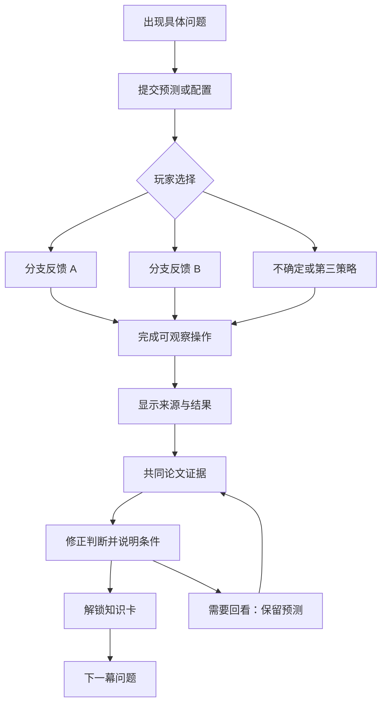

# THE ADAPTIVE ENGINE — 自适应引擎

> 当前默认网页采用 [Robot-Revision.md](Robot-Revision.md) 的机器人故事版本；本文件保留为早期方案与证据边界参考。
> 有限的预算，如何做出最重要的改变？

阶段：ACT 0–9 已开放；探索与复习的新规则见 [Exploration-Revision.md](Exploration-Revision.md)。最新约定见 Beginner-Revision.md：通俗引导、ACT 1 内的 LoRA 回顾、主线路线图与连续分段布局；原有卡片式呈现不再采用。

## 1. 故事契约与知识主线

玩家是 **Chief Adaptation Engineer / 首席适配工程师**。一座维多利亚时代的 Transformer 工厂已经用 LoRA 学会低成本适配新任务。资源委员会现在削减预算。各部门沿用预先设定的 Rank，但它们的任务需求并不一致。玩家不是来背算法，而是接管一套不够灵活的分配制度，逐步找到结构、判断依据与调度机制。

工厂是低秩适配的类比，蒸汽压力不是模型准确率。冻结的预训练引擎始终作为背景结构；玩家操控的是旁路中的增量更新。镜头、机械动作、图形和反馈只表现当前概念。齿轮不承担装饰性背景循环。

主线为：预算危机 → 模块差异 → Rank 取舍 → 可调整的方向结构 → 有噪声的重要性估计 → 动态预算调度 → 实验边界 → 消融检验 → 分配观测 → 工程审查。

### 编号

使用 **ACT 0–ACT 9，共十幕**。预算危机为 ACT 0，初始预测在 ACT 8 回访。ACT 1 先回顾 Transformer、LoRA 的位置和省参数原因，再进入模块议会。封面不是额外一幕。

### 每幕的固定节奏

1. **问题出现**：一个具体矛盾，最多两句对白。
2. **提出假设**：预测或初始方案，答案提交前不揭示本幕核心结论。
3. **进行操作**：一个主要控件，产生可观察的结构或状态变化。
4. **观察结果**：解释当前来源；模拟只报告模拟量。
5. **对照论文**：显示研究问题、控制条件、相对表现、趋势、适用范围、图表位置。
6. **修正认识**：再次判断或完成变量关系句子；允许保留“证据不足”的回答。
7. **解锁发现**：知识卡加入工程日志，留下下一幕的问题。

新学习路径必须经历预测、操作、证据和修正四个关口。答错不会扣除预算、重置进度或跳过关键知识。回看模式允许直接打开已读证据，不再强制重复作答。全章节导航始终可达；首次直接进入后面的章节时，先提示必要前置概念，并在该幕内补足它们，不能把导航禁用当教学。

### 三种来源始终分开

| 类型 | 页面标签 | 可展示内容 | 禁止内容 |
| --- | --- | --- | --- |
| `paper_evidence` | 论文证据 · Figure / Table / Section | 原始数值、作者论述、注明计算方式的派生比较 | 随用户操作改写实验结果 |
| `conceptual_simulation` | 教学模拟 · 不代表真实训练 | 秩上限、活跃方向、结构变化、人工构造的评分信号 | 虚构准确率、F1、ROUGE、训练日志 |
| `hypothetical_scenario` | 假设情境 · 剧情设定 | 工厂危机、委员会对白、假设预算 | 伪装为论文实验条件 |

故事层和科研层使用分别带标签的区域，不能以一个“论文证据”标签覆盖整块模拟画面。

## 2. 完整 Storyboard、知识对应与交互原型

### ACT 0 · 预算危机 / Budget Crisis

**研究问题**：相同预算是否意味着相同适配效果？平均分配是否一定公平且高效？

**场景**：深棕黑的主引擎大厅。预训练引擎巨大而沉静，黄铜旁路计量板位于前景。委员会递交削减通知：“预算必须收紧。沿用旧配额，还是检查分配制度？”

**初始状态**：四个抽象部门，各 3 枚容量筹码，总数 12；这不是论文的真实参数配置。玩家先回答“各部门需要相同容量吗？”并选择“暂时平均分配”或“尝试不同配额”。

**操作原型**：

```text
首席适配工程师任命书         [假设情境]
你的假设：[平均配额足够] [需求可能不同] [暂时无法判断]
               冻结的 Transformer 主引擎
  部门 A  ●●●   B ●●●   C ●●●   D ●●●
[暂时平均分配] [调整一枚筹码]      容量筹码 12 / 12
反馈区 → [查阅委员会的研究附件] → Figure 1 条件与结果
[平均分配是否一定高效？] → 解锁发现
```

调整只改变机械配额和“谁获得更多容量”，不生成任务分数。“暂时平均分配”会亮起相同的容量窗，反馈：“份额一样；你还没有证据说明需求一样。”另一分支反馈：“配额发生变化；仅凭变化还不能判断是否更好。”

**证据与修正**：两个分支均打开同一 Figure 1 附件：DeBERTaV3-base、MNLI-m、总可训练参数 0.28M，投到不同矩阵类型或层组会产生不同表现。图中没有“玩家刚刚分配的方案”结果，也不是平均分配与玩家方案的实测对照。玩家用附件判断“仅看份额相等能否证明高效？”

**解锁**：“同样预算，不同分配方式可能表现不同。”

**下一问**：“如果部门需求不同，先调查谁？”

**组件与状态**：MechanicalEngine、BudgetAllocator、EvidenceChart；`initialBelief`、`crisisPolicy`、`crisisAllocation`、`fig1IntroRead`、`crisisRevision`。键盘用部门选择与加减按钮代替拖拽。手机四部门纵排；总额条保持可见。

**五问验收**：问题＝等额是否高效；判断＝初始策略；证据＝Figure 1 同预算异配置；关系＝预算量与预算位置是两件事；来源＝工厂配额为假设，附件为论文证据。

### ACT 1 · 模块议会 / Council of Modules

新版前置部分：先点击 Transformer 的一层认识 Attention（找信息之间的关系）与 FFN（加工信息）；找到主矩阵旁的 LoRA 更新支路，比较全部训练与只训练两张小表。用教学尺寸解释参数差异，再说明相同 Rank 的旧配置没有考虑位置差异，过渡到下述模块实验。具体引导与交互见 Beginner-Revision.md。

**研究问题**：相同可训练参数预算，投入哪类矩阵或哪组层更有效？

**场景**：议会蓝图上依次出现 Attention 与 FFN 两类结构，随后展开 12 层的垂直建筑剖面。每次只操作一种实验视角。

**初始状态**：研究档案关闭；玩家先预测 Attention、FFN 或无法确定。Attention 不是一个可与 FFN 直接合并比较的独立实验点，它展开为 Wq、Wk、Wv、Wo；FFN 展开为 Wf1、Wf2。

**操作原型**：

```text
[矩阵类型] [层组]         固定参数预算 0.28M [论文条件]
预测 → 选择一个实验配置 → [揭示记录]
矩阵：Wq Wk Wv Wo | Wf1 Wf2
层组：1–3 | 4–6 | 7–9 | 10–12
          羊皮纸实验比较图
选中配置描边；全部对照保持可见；原值可展开
修正：[该设置支持 FFN / 高层] [所有任务都如此]
```

操作是**选择实验档案**，不是即时训练。模块选择会更新蓝图高亮、配置摘要和对应的已发表柱状图。层组与矩阵类型来自两个独立实验，不能混合成“FFN 高层”的新测量。

**证据**：Figure 1a，MNLI-m Accuracy：Wq 88.58、Wk 88.98、Wv 89.36、Wo 89.28、Wf1 89.91、Wf2 89.99。Figure 1b：层组 1–3 为 77.87，4–6 为 85.82，7–9 为 88.15，10–12 为 88.60。主画面强调排序与差异，原值放入可展开表。局部轴必须标出范围，旁边提供完整数值，避免小差距被视觉夸大。

**反馈分支**：猜 FFN：“该实验支持你的预测；换任务还需要新证据。”猜 Attention：“这个设置的结果与你的预测不同；Attention 仍是重要结构，不能据此判定它无价值。”猜未知：“先保留判断，再观察受控比较，这是有效的研究决策。”

**修正**：明确限制在模型、任务、预算和配置；不能推导为所有 Transformer 的部门优先级。

**解锁**：“Importance varies across modules. 不同模块的适配价值可能不同。”

**下一问**：“改变配额，具体是在改变什么？”

**组件与状态**：MechanicalEngine、RankVisualizer、EvidenceChart；`modulePrediction`、`layerPrediction`、`moduleExperimentSelection`、`layerExperimentSelection`、`moduleRevision`。两种视角都至少查看一个对照。按钮与图形高亮共享同一状态；Tab、Enter 可完成全部流程。

**五问验收**：问题＝在哪里投入；判断＝模块与层组预测；证据＝Figure 1a/b；关系＝同预算下配置位置影响结果；来源＝选择只索引真实档案。

### ACT 2 · Rank 配额室 / Rank Allocation

**研究问题**：增加某个模块的低秩适配容量，需要付出什么代价？

**场景**：四个黄铜方向匣与一只机械分配臂。只有筹码转移时分配臂运动；没有自动传送带。

**初始状态**：四个同尺寸的教学矩阵，每个 `d1=d2=64`，Rank 为 `[3,3,3,3]`；总 Rank 12，总 LoRA 因子参数预算 1536。该尺寸为教学设定。玩家预测“给一个矩阵加 Rank，能否不影响别处？”

**操作原型**：

```text
[教学模拟] 总 Rank 12 / 12 · 因子参数 1536 / 1536
来源部门 [A ▼] → 目标部门 [B ▼] → [转移 1 个 Rank]
A [− 3 +]   B [− 3 +]   C [− 3 +]   D [− 3 +]
     容量窗同步变化；[与初始配额对照] [恢复平均]
观察：一处扩容，另一处收紧。模型准确率：未测量。
```

**有效状态**：每项整数 0–8，总和始终 12。加号需要先选择减配来源；没有来源或来源为 0 时阻止提交，并用文字说明。滑块若采用，必须通过转移事务维护总额，不能悄悄把其他模块按比例改变。主要操作是筹码转移，滑块只是等价输入。

**证据与修正**：Section 2、Eq. 1–2 说明 LoRA 因子和 Rank；Section 3.3 用总 Rank 作为全局调度预算。等 Rank 并不在任意不同尺寸矩阵中代表等参数量。技术抽屉用 `r × (d1+d2)` 解释原理；SVD-like 结构还具有每方向的 λ 参数。本章固定同尺寸，使 Rank 守恒确实对应因子参数预算守恒；真实矩阵尺寸变化的情形留在技术层说明。

**反馈**：“你增加了 B 的容量，同时缩减了 A；现在还不知道这笔交换是否适合当前任务。”不授予“最优分配”奖牌，不按 Figure 1 排序自动给玩家分配打模型性能分。

**解锁**：“Rank 是控制低秩适配容量的重要变量；容量增加不保证准确率提高。”

**下一问**：“谁来决定正确的分配方式？”

**组件与状态**：BudgetAllocator、RankVisualizer；`rankAllocation`、`rankTransfers`、`capacityPrediction`、`capacityRevision`。手机为部门列表与来源/目标按钮；拖拽只作为桌面增强。

**五问验收**：问题＝扩容代价；判断＝预算能否免费增加；证据＝LoRA 因子结构与总 Rank 定义；关系＝容量、位置、总预算约束；来源＝机械配置和尺寸均为模拟。

### ACT 3 · 奇异方向工坊 / Singular Foundry

**研究问题**：怎样暂时抑制一个更新方向，又不把它的方向结构一起抹去？

**场景**：第一高潮。冻结的主引擎后方出现透明旁路；旁路被展开成 P 输出侧方向、Λ 强度控制器、Q 输入侧方向。以一个三元组为主角，不把数据画成穿越多个工位的货物。

**初始状态**：三个示意方向，强度 `[0.8,0.5,0.2]`，只显示相对更新贡献。玩家先选“移除整对因子”或“先将强度调为零”，预测是否能够恢复。

**操作原型**：

```text
[LoRA 结构剪枝示意] [SVD-like 适配示意]  [教学模拟]
输入侧 Q ── 强度 Λ ── 输出侧 P     ΔW 的方向视图
方向 1 [开启]   方向 2 [开启]   方向 3 [强度归零]
[查看保留结构] → [模拟下个更新间隔] → [尝试恢复]
贡献关闭 ≠ 参数存储删除
```

**观察**：λ 为 0 时，该方向的当前贡献消失，但 P/Q 的轮廓保留；删掉一整对 A/B 的教学分支，两个因子轮廓一起清空。引擎输出仅画成方向叠加示意，不显示准确率。

**证据**：Section 3.1、Eq. 3–4；Section 4 的 Implementation Details 说明按间隔进行掩蔽，使被抑制方向有机会在后续迭代中重新激活；结构剪枝比较由 Table 4 提供。不是每一步执行精确 SVD，而是直接训练 SVD-like 因子。

**技术边界**：恢复按钮是结构可能性的模拟，不证明真实训练会恢复。λ=0 不代表 P/Q 因任务损失获得同样梯度；保留参数、正交正则以及掩蔽之间的后续更新共同构成可能性。不能宣布“零贡献立即释放全部训练显存”或“删除 λ 不需要保留 P/Q”。低秩预算、有效贡献、参数存储必须分开。

**可选抽屉**：正交约束使方向尽量减少重叠；通过旋转两根方向杆展示“重合”与“近似独立”，标签写“正则鼓励近似正交”，不能说天然完美正交。无推导，主线只出现 `ΔW = PΛQ` 这一个结构表达式。

**反馈**：“你关闭的是这个方向此刻的贡献，方向结构仍被保留；这留下重新参与的可能，而非恢复保证。”

**解锁**：“贡献强度可以被选择性抑制；可调整的结构为后续重新分配留下余地。”

**下一问**：“哪些方向应该留下？”

**组件与状态**：SingularTriplet、RankVisualizer、EvidenceChart；`tripletMode`、`lambdaMask`、`recoveryDemoStep`、`recoveryPrediction`、`orthogonalityInset`。

**五问验收**：问题＝如何可逆抑制；判断＝零强度与全结构删除；证据＝Section 3.1、掩蔽间隔、Table 4；关系＝因子结构、强度与有效贡献；来源＝恢复动画明确为模拟。

### ACT 4 · 重要性裁判所 / Importance Tribunal

**研究问题**：看起来大的零件，是否就更值得保留？当前批次的判断可靠吗？

**场景**：黄铜计量尺、敏感性指针与历史记录卷。先只有大小刻度；随着玩家选方法，逐层增加测量信息。

**初始状态**：四个教学三元组、六个固定人工批次信号。数据生成方式写入模拟记录；不存在隐藏的真实重要性标签或模型效果。预测选项：仅看强度大小、仅看当前批次敏感性、结合历史敏感性与变化。

**操作原型**：

```text
预测 → [大小] [当前敏感性] [历史与变化]   [教学模拟]
四个方向的评分卡         [上个批次]  3 / 6  [下个批次]
选出的保留集合          历史敏感性轨迹 / 局部变化
反馈：排名如何变化；未测量准确率
[对照论文评分设计] → [检查单项例外] → 修正判断
```

**主要动作**：选择评分依据并逐步查看同一信号序列；高亮的保留集合随评分改变，显示为什么排序变化。模拟轨迹可计算论文的 EMA 与乘积机制，但不能为了剧情保证“历史方法总是最稳、总是最好”。

**证据**：Section 3.2、Eq. 7–11；敏感性以权重与梯度乘积的绝对值近似参数归零对损失的影响。完整评分先计算平滑敏感性与局部变化的乘积，再汇总 λ 的分数及 P/Q 两侧方向参数的平均分数，最后用于三元组的全局排序。

**关键纠偏**：变化项不是简单的“波动越大扣分”，论文采用乘积；历史评分也不是精确因果检验。Table 4 通常支持完整设计，但 RTE、0.65% 档中仅敏感性变体 88.10，完整 AdaLoRA 88.09，不能宣传每格都更好，也不能为此声称变体显著更优。

**反馈分支**：大小法：“强度告诉你当前贡献的尺度，不能单独告诉你任务损失的敏感程度。”单批次法：“你利用了训练信号，但这个批次未必代表之后的训练。”历史法：“你选择了论文采用的综合信息；它仍是有噪声的估计，且变化项不只是滤噪惩罚。”

**解锁**：“重要性需要通过训练信号估计；评分高代表当前保留优先级，不保证更高准确率。”

**下一问**：“知道该保留谁，应该什么时候削减？”

**组件与状态**：ImportanceMeter、EvidenceChart；`importancePrediction`、`scoringMode`、`batchIndex`、`selectedTriplets`、`importanceRevision`。固定样本可重现；“下一批次”是动画步进标签，不使用“训练成功”。

**五问验收**：问题＝怎样判断价值；判断＝评分依据；证据＝Eq. 7–11、Table 4；关系＝参数值、梯度、历史与变化影响估计；来源＝人工信号和已发表消融分别标记。

### ACT 5 · 预算控制塔 / Budget Control Tower

**研究问题**：应该立即削减、保持不变，还是先探索再逐步收紧？

**场景**：第二高潮。一个巨大黄铜预算表控制旁路中同时激活的方向。表针的变化严格由预算状态驱动。

**初始状态**：示意总 Rank 24、目标 16、12 个教学时间点。玩家选择三种策略并解释“什么时候能积累判断依据”。24/16 只是采用 1.5 倍初始预算的示例，不是论文全部实验的固定设置。

**操作原型**：

```text
[立即削减] [永不削减] [预热→逐减→固定]  [教学模拟]
          黄铜预算表：活跃方向 / 当前预算
Warm-up —— Progressive Reduction —— Final Fine-Tuning
[上一步]  教学时间 5 / 12  [下一步]
当前阶段：有效方向集合与预算走势
[查看论文调度方式] → [判断目标预算与分配是否都固定]
```

**观察与分支**：立即削减从起点就只显示目标数量，反馈“可供探索的方向先被限制；这里没有真实效果测量”。永不削减保留 24，反馈“超过最终目标，尚未满足预算约束”。三段策略预热不减、按三次曲线示意收缩、最后固定保留集合并继续优化其参数。任何分支都必须切换到三段策略并完成三个阶段的观察。

**证据**：Section 3.3、Appendix A、Algorithm 1。按全局重要性选择 top-b(t)，不是每个矩阵独立平均削减。预热用于先探索，后期固定的是**分配和掩蔽集合**，不是冻结所有参数。训练继续优化保留结构。

**边界**：原文没有该三种策略的完整定量实测对照。本章给出方法依据与预算可行性，不生成三条虚构的验证损失或准确率曲线。曲线展示“预算随教学时间变化”，不能叫“论文训练日志”。Appendix A 原式需在开发时结合 Section 3.3 核对边界；用归一化的三次下降示意必须标明示意，不逐字冒充复现。

**解锁**：“动态分配需要合理的时间安排：先积累信号，再收紧预算，最后稳定优化。”

**下一问**：“这套设计在真实任务中表现怎样？”

**组件与状态**：BudgetTimeline、ImportanceMeter、MechanicalEngine；`schedulePrediction`、`schedulePolicy`、`timelineStep`、`phase`、`scheduledRankBudget`、`finalMask`、`scheduleRevision`。

**五问验收**：问题＝什么时候削减；判断＝三种策略；证据＝Section 3.3/Appendix A；关系＝时间、预算、估计与稳定优化；来源＝没有模拟性能曲线。

### ACT 6 · 参数预算竞技场 / Performance Arena

**研究问题**：在可比预算下，动态分配是否更有竞争力？增加预算的收益是否因任务而异？

**场景**：三个研究房间。比赛动画用于展开已发表对照，条形长度表示选定指标；不使用火力、蒸汽压力或玩家配额推算准确率。

**初始状态**：每个房间结果收起。先预测“更多预算必然更好”“AdaLoRA 逐项最佳”“优势依任务和指标变化”中的一项，再挑预算档和指标。

**操作原型**：

```text
[NLU] [QA] [NLG]        [论文证据 · Table 1/2/3]
预测 → 数据集 [▼] 预算档 [▼] 指标 [▼] → [揭示已发表结果]
       方法比较图 + 实际参数量 + 可展开原表
[比较低/高预算] → [寻找一个例外] → 本房间修正
三个房间都有证据记录之后，解锁本幕发现
```

**NLU 房间**：DeBERTaV3-base、GLUE development、Table 1，五随机种子均值。显示 LoRA、AdaLoRA、Houlsby/Pfeiffer Adapter 与 BitFit；Full FT 作为高预算参考，不能放入“同预算赛道”。Table 1 的低档实际数量分别为 LoRA 0.33M、AdaLoRA 0.32M、HAdapter 0.31M、PAdapter 0.30M，所以称“近似预算档”，不能标为完全相等。主线可用 CoLA 和 RTE；完整数据在抽屉中。GLUE 不同指标不画成同一纵轴。

**QA 房间**：DeBERTaV3-base、SQuAD v1.1/v2.0、Table 2，EM 或 F1 单独选择。0.08% 档 SQuAD v2 F1：LoRA 87.5、AdaLoRA 88.7、HAdapter 86.6、PAdapter 87.2。AdaLoRA 跨预算变化较小，但并非严格单调；0.16% 88.8 → 0.32% 88.6 是可见例外。

**NLG 房间**：BART-large、XSum/CNN-DailyMail、Table 3，仅 LoRA、AdaLoRA 和 Full FT 参考有该表证据。Adapter 卡显示“本表未报告”，没有柱子、估算或跨任务借值。预算切换与 Figure 2c 支持 XSum 收益趋势的教学讨论。Table 3 的 CNN/DailyMail 2.20% 档 ROUGE-1：LoRA 45.03、AdaLoRA 45.00；ROUGE-2/L 则分别 21.84/42.15 与 21.89/42.16。保留这种不同指标方向并存的结果。

**Figure 2**：只引用曲线中有依据的趋势；当前数据文件不从图线粗略读取未标注数字，不把它与 Table 3 连接为一组训练曲线。Figure 2 的 XSum 底座为 BART-large，以任务章节为准，原文 4.4 首句笼统提到 DeBERTa 不能被复制成所有子图模型相同。

**反馈**：“这些是在指定模型、数据集和预算条件下的结果。AdaLoRA 通常有竞争力，但任务、预算和指标会改变差距。”

**解锁**：“有限预算下，重要性感知分配通常更有竞争力；收益和例外必须放回具体实验条件。”

**下一问**：“效果来自哪个设计，还是仅仅换了名字？”

**组件与状态**：EvidenceChart、EngineersJournal；`roomPredictions`、`roomSelection`、`datasetSelection`、`metricSelection`、`budgetBand`、`roomEvidenceViewed`、`exceptionIdentified`、`performanceRevision`。

**五问验收**：问题＝可比预算效果；判断＝任务/预算/方法预测；证据＝Table 1–3、Figure 2；关系＝收益受任务预算指标影响；来源＝方法条形由只读论文记录绘制。

### ACT 7 · 消融实验室 / Ablation Laboratory

**研究问题**：哪些机制对结果有贡献？为什么不能把移除组件的影响简单相加？

**场景**：引擎的研究版剖面，四枚实验开关。每次只允许一个预设变体处于激活态；开关是“读取消融档案”，不是现场重新训练。

**初始状态**：完整 AdaLoRA。用户每次先预测“降低”“接近”“不确定/可能有例外”，再执行一个拆解实验。

**操作原型**：

```text
预测 → 选择单一变体 → [打开对应消融记录]
[替换 SVD-like 结构] [移除自适应分配]
[移除正交正则] [简化重要性评分]
完整方法 ↔ 已发表变体          [论文证据 · Table 4/5]
保持条件 / 改动项 / 未能隔离项
[恢复完整设计] → 下一张消融档案
```

**预设映射**：

| 玩家动作 | 真实变体与证据 | 可以回答什么 | 必须说明的控制条件 |
| --- | --- | --- | --- |
| 替换 SVD-like 结构 | Prune LoRA 对 AdaLoRA，Table 4 | 结构化剪枝 LoRA 与论文结构的差异 | 同评分、同调度、同训练设置；改变的不只是一个 UI 零件，还包括因子结构与剪枝方式 |
| 移除自适应分配 | SVD-LoRA 对 AdaLoRA，Table 5 | 固定低秩结构不足以替代动态分配 | SVD-LoRA 保留 Eq. 3/4；按论文预算档比较，不能当成逐步训练日志 |
| 移除正交正则 | AdaLoRA γ=0 对完整方法，Table 5 | 该设置下正则的贡献 | 采用原表的任务、预算和指标；不声称所有方向即时失控 |
| 简化重要性评分 | sensitivity-only / λ 的绝对值，对完整方法，Table 4 | 评分设计的价值及单项例外 | 两个真实预设，不能任意拼成未报告的组合 |

所有四张档案必须看完，但错误预测只触发解释，不锁死路径。用 SST-2 和 MNLI 的 Table 5 面板；Table 4 用 SST-2、RTE、CoLA。MNLI 在 Table 5 是 m/mm accuracy 的平均，不能与 Table 1 的单列 MNLI-m 直接相减。

**缺失值**：Table 5 的破折号是未报告，数据为 null；不等于零，不插值。多个开关同时关闭时不提供“组合性能预测”，只提示“该组合未报告”。

**反馈**：“实验支持多项设计的贡献；它没有给出一个可任意相加的组件功劳表。”

**解锁**：“AdaLoRA 的效果来自结构、评分、分配与正则的配合；消融结论依赖控制变量。”

**下一问**：“训练最终究竟把容量留在哪里？”

**组件与状态**：MechanicalEngine、EvidenceChart；`ablationPredictions`、`activeAblation`、`ablationVariant`、`ablationEvidenceViewed`、`controlsAcknowledged`、`ablationRevision`。

**五问验收**：问题＝多项设计贡献；判断＝逐项移除预测；证据＝真实 Table 4/5 变体；关系＝改动条件与结果；来源＝UI 禁止生成未发表组合结果。

### ACT 8 · Rank 分布观测站 / Rank Observatory

**研究问题**：最终 Rank 分布是否真的支持我们最初的直觉？它有哪些例外？

**场景**：第三高潮。顶部观测窗展开为羊皮纸的 6×12 蓝图，铜色到青绿色表示最终 Rank，0–12 使用同一固定色标。先隐藏数值，等待玩家提交“较低层/较高层”“Attention/FFN”的分布预测。

**操作原型**：

```text
预测 → [揭示 Figure 3]
模块筛选：[全部] [Attention] [FFN]
层筛选：[全部] [较低 1–6] [较高 7–12]
            12 层 × Wq Wk Wv Wo Wf1 Wf2
选中格：第 12 层 / Wf2 / 最终 Rank 0
[找一个反例] → [回访 ACT 0 的预测] → 修正认识
```

**证据**：Figure 3、PDF 第 10 页，DeBERTaV3-base、MNLI。保留全部 72 个图中标注值，不用美术重排或“理想分配图”替换。

**必须保留的细节**：Wf1 在许多中高层达到 12，但 Wf2 并不处处高于 Attention；Wo、Wv、Wk 也有很多高 Rank 格子。最后一层 Wf1=2、Wf2=0、Wq=3，是对“层越高 Rank 越高”的直接反例。不能把 Figure 3 概括成“每个 FFN 都比 Attention 获得更多预算”。

**解释层次**：作者在 Section 4.4 将分布概括为更偏向 FFN 和较高层；页面将该概括与具体图中例外并列。玩家需要找出“支持这个概括的区域”及“一处不符合简单规则的区域”。这使 Figure 1 的受控表现比较与 Figure 3 的最终分配观察互相参照，而非把最终 Rank 当作模块准确率。

**闭环**：日志并排显示 ACT 0 原始判断和现在的回答。按钮“保留假设但补充条件”“修改假设”“证据仍不足”都可通过；通过依据是解释包含条件与边界，而不是是否选了预定漂亮答案。

**派生聚合**：允许显示选中区域的平均/总 Rank，但必须标“由 Figure 3 格值计算”，不称原论文额外实验；默认不开跨模块均值排名。低层/高层二分是界面筛选，不是 Figure 1 中三层一组的原实验。

**解锁**：“最终分配不是均匀图，也不是单调规则；需要观察具体模块、层和任务。”

**下一问**：“这套方案在哪些条件下值得批准？”

**组件与状态**：RankVisualizer、EngineersJournal、EvidenceChart；`distributionPrediction`、`moduleFilter`、`layerFilter`、`selectedCell`、`counterexampleCell`、`revisitedBelief`、`distributionRevision`。方向键移动格子，Enter 查看稳定详情；手机可横向滚动蓝图，并提供同值的“选择层→模块列表”替代。

**五问验收**：问题＝分布与直觉；判断＝预测与找反例；证据＝Figure 3 原始格值；关系＝最终 Rank 是学习到的容量分配而非准确率；来源＝原值与派生筛选分别标记。

### ACT 9 · 工程审查室 / Final Verdict

**研究问题**：为什么有限参数需要根据重要性动态分配？哪些机制使它可行？什么仍未被证明？

**场景**：安静的工程审查桌。全部知识卡放在羊皮纸蓝图上，工厂旁路停留在可检查状态。最终不是完美机器，而是一份有条件的工程批准。

**初始状态**：知识卡以稳定的打乱顺序排列；先回答最终问题，再进行排序。未学完章节可回看，未读证据不能被日志伪装为已读。

**操作原型**：

```text
LoRA 的预算限制 → 模块差异 → 可调整结构 → SVD-like
→ 重要性感知分配 → 全局预算调度 → 条件内更有效适配
[上移] [下移] / 拖动知识卡
逐条配对：“观察” / “论文证据” / “仍需新实验”
最终回答：为什么分配？如何实现？哪些局限？
[提交工程审查] → 学习报告 → 回看 / 复习 / 导出
```

排序反馈解释依赖关系，接受等价合理顺序。例如先讲调度再讲评分，只要回答说明“按什么分”和“何时收紧”，不机械判错。自由回答保存在本地并展示，不宣称 AI 自动确认事实；结构化选择题检验四个变量关系，自由回答用于自评。

**必要局限卡**：不同任务可能需要不同预算；重要性估计存在噪声；训练增加一部分计算；原论文主要验证语言理解、问答和文本摘要任务；多模态应用需要另行实验证明。

**来源边界**：预算依任务见 Figure 2；估计噪声见 Section 3.2；训练开销见 Appendix H / Table 15；任务范围见 Section 4.1–4.3。多模态卡写“本文没有提供多模态实验，不能据此断言其效果”，这是证据范围判断，不冒充作者报告的多模态结论。原文 Appendix H 正文写 SQuADv2，但 Table 15 的第二任务标签为 SST-2，因此开销主线只使用无冲突的 MNLI 行，第二任务暂不形成定量结论。

**最终画面**：

> ENGINE ALLOCATION APPROVED
>
> Not every parameter needs the same budget.
>
> 审查通过：你已说明分配依据、可调整结构与时间安排。真实任务仍需要验证。

**报告**：初始预测、每幕修正、已阅证据、找到的例外、知识地图、待复习概念和最终自述。报告只评价学习判断，不报告“你训练出的模型分数”。提供可打印 HTML 视图与 JSON 下载；默认不上传，不依赖账号。

**组件与状态**：EngineersJournal、KnowledgeDrawer、FinalVerdict；`cardOrder`、`relationAnswers`、`scopeAnswers`、`finalExplanation`、`selfReview`、`verdictApproved`。卡片排序必须同时支持上/下移按钮；读屏宣布新位置。批准门槛是完成证据阅读并正确识别边界，错误时指出需要回看的内容，保留原始回答。

**五问验收**：问题＝为什么/如何/边界；判断＝排序、范围配对与最终解释；证据＝全文机制及实验范围；关系＝容量、重要性、结构和调度共同作用；来源＝学习报告不生成模型表现。

## 3. 用户决策分支与汇流

每幕允许不同剧情反馈，但所有分支汇入同一证据关口。主线不是“猜中才揭示论文”，也不是“猜错直接跳过”。



| ACT | 分支输入 | 分支差异 | 必经汇流点 |
| --- | --- | --- | --- |
| 0 | 平均 / 调整 / 暂不判断 | 配额与对白变化 | Figure 1 同预算不同配置 |
| 1 | Attention / FFN / 层组预测 | 蓝图选中项与预测对照 | 两个独立实验及范围限制 |
| 2 | 转移方向与数量 | 容量窗不同 | 总预算守恒、效果未知 |
| 3 | 结构删除 / 强度归零 | 因子保留与恢复可能不同 | SVD-like、掩蔽与存储区别 |
| 4 | 三类评分依据 | 同一信号序列下排名不同 | 完整评分结构及噪声 |
| 5 | 三种调度策略 | 活跃方向和预算曲线不同 | 三段式调度完整观察 |
| 6 | 方法与收益预测 | 预测对照与找到的例外不同 | 三个任务房间与原表范围 |
| 7 | 四类消融预测 | 真实变体档案不同 | 全部四类记录与控制变量 |
| 8 | 模块/层预测 | 原始判断回访不同 | 图中支持区域与至少一个例外 |
| 9 | 卡片顺序与自述 | 反馈和复习建议不同 | 机制链与五项现实局限 |

## 4. 三个高潮动画的导演说明

### 高潮一：ACT 3，拆开一个更新方向

**意图**：看见“方向”和“强度”是不同可操作对象。主角是一个三元组。

**节拍**：0–0.7 秒锁定旁路，主引擎保持静止；0.7–1.5 秒拉开输入侧 Q 与输出侧 P 的结构；1.5–2.2 秒中央 Λ 控制器显现；等待玩家操作；归零后 0.5 秒内贡献带收缩至零，P/Q 骨架保持；玩家主动步进后，0.8 秒内显示后续重新激活的教学可能。任一节拍可暂停或跳到静态检查态。

**映射**：杆的朝向＝方向示意，控制器开度＝λ 相对强度，贡献带是否存在＝当前贡献。机械强度不映射准确率；恢复只标模拟。轻微青蓝光只出现在选中且有效的适配旁路，不用大面积霓虹。

**实现预案**：SVG 组的 transform 与 opacity；Framer Motion 编排组展开。归零、保留、尝试恢复来自同一状态；不靠动画计时写入学习进度。减弱动画模式用三个静态切片与上一/下一步按钮。

### 高潮二：ACT 5，预算表收紧而方向仍被优化

**意图**：分配是一个有时间结构的过程。主角是全局预算表。

**节拍**：玩家预测后开表；预热阶段计量表不下降；逐减阶段表针按教学预算移动，排序较低方向的贡献窗关闭；最后到目标预算，掩蔽集合锁定，保留方向的参数仍有细微状态变化。主线始终保留三阶段文字。

**映射**：表针＝总 Rank 配额，亮窗数量＝允许的有效方向，固定框＝最终保留集合。没有损失曲线、训练准确率或“收敛成功”日志。排名变化可使方向在逐减期间切换；最终阶段不再更换集合。

**实现预案**：BudgetTimeline 用离散教学步驱动归一化曲线，SVG 表针仅作数值过渡；屏幕外暂停。减弱动画时直接更新数值、集合和阶段摘要，用户仍完成相同的操作与判断。

### 高潮三：ACT 8，答案是一张有例外的图

**意图**：形成认知闭环，而非制造“一眼看出标准答案”的热力图。

**节拍**：玩家预测后，0.8 秒展开整张蓝图；随后全部真实格值一起呈现，不能先把 FFN 高层挑亮来引导答案；等待筛选与选格；玩家找到支持区域和反例后，ACT 0 预测纸条进入并排日志。过渡结束不自动判“你当时错了”。

**映射**：颜色和格内整数均来自 Figure 3；筛选只是变淡非选中格，色标保持 0–12。第 12 层与低 Rank FFN 格不能被隐藏、平滑或插值。选中格的描边不用修改真实色值。

**实现预案**：RankVisualizer SVG，DOM roving tabindex 网格或等值按钮列表，稳定详情面板。Framer Motion 仅处理画卷和选中边框；减弱动画直接出现完整原值图。

## 5. 本阶段交付与开发节奏

本文件覆盖完整 Storyboard、各幕论文对应、分支流程、逐幕文字交互原型和三个高潮说明。[Engineering-Spec.md](Engineering-Spec.md) 覆盖全局状态、组件架构、数据结构、知识补给和视觉交互规范；`paper-evidence.json` 保存已核对的原始数据与来源。

用户确认方案后，只实现 **ACT 0** 与支撑它所需的最小公共框架。通过五问检查、类型/构建检查、桌面/手机布局和键盘检查后，交给用户评阅；每次仍只实现一幕。后续继续请求是开发下一幕的授权，不把整体方案确认解释为一次开发十幕。

每幕交付说明固定回答：用户产生什么问题、主动判断是什么、得到什么论文证据、理解了什么变量关系、是否明确区分教学模拟。组件复用可以整理，但不提前实现其他 ACT。

功能 2 尚处于用户指定的方案阶段，当前不宣称初版生成完成，不提供不存在的构建或预览结果，不自动进入人工校验、导入或 PR 阶段。

## 原始来源

主要依据是用户提供的《AdaLoRA: Adaptive Budget Allocation for Parameter-Efficient Fine-Tuning》PDF，页码与图表引用均以该 17 页文件为准。版本文件名为 `2303.10512v2.pdf`；公开版本入口为 [arXiv:2303.10512v2](https://arxiv.org/abs/2303.10512v2)。公开页用于核对题名和版本身份，不替换上传文件中的实验记录。原文内部有个别正文、表格或附录冲突，见 Engineering-Spec 的证据边界记录，不能由教程补造数据。
