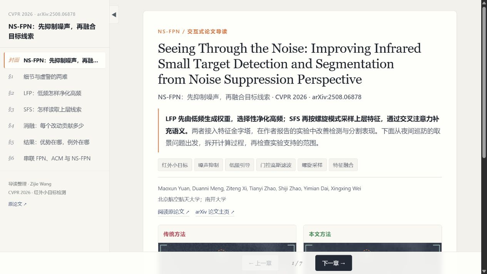
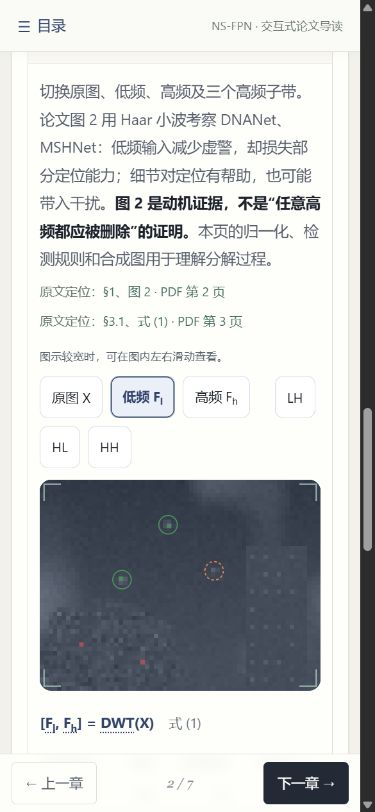

# NS-FPN：红外小目标检测与分割交互式论文导读

本项目讲解 **Seeing Through the Noise: Improving Infrared Small Target Detection and Segmentation from Noise Suppression Perspective**，发表于 CVPR 2026，第 27783–27792 页。作者为 Maoxun Yuan、Duanni Meng、Ziteng Xi、Tianyi Zhao、Shiji Zhao、Yimian Dai 和 Xingxing Wei。

导读整理：Zijie Wang（GitHub：[mathlover0728](https://github.com/mathlover0728)）。

## 阅读内容

导读从“增强目标细节时，为什么也可能增加虚警”出发，依次解释频率分解、LFP、SFS 与实验依据。采用六章阅读结构，每章包括一个可操作的夜间巡防类比、两个主题交互、关键结论与原文定位。

| 章节 | 内容与主要操作 |
| --- | --- |
| 1. 细节与虚警的两难 | 调整高频权重，切换低频和三个高频子带，区分目标细节与背景干扰。 |
| 2. LFP：低频怎样净化高频 | 观察低频引导的空间权重，调整门控阈值与高斯平滑参数，跟踪逆小波重建。 |
| 3. SFS：怎样读取上层线索 | 移动查询位置，调整螺旋采样参数，逐步查看 query、key/value 与残差融合。 |
| 4. 消融：每个改动贡献多少 | 切换 LFP、SFS 和数据集；检查层级消融及头数、点数实验。 |
| 5. 结果：优势在哪，例外在哪 | 按任务、数据集和指标比较原表，检查 PANet 的 Fa 与 EFLNet 的 mAP50 反例。 |
| 6. 串联 FPN、ACM 与 NS-FPN | 对照三种特征融合结构，通过自测核对方法、数字与结论范围。 |

可使用目录、上一章/下一章按钮或键盘左右方向键切换章节。手机端通过顶部目录进入各章；滑块、选择按钮和图中可操作区域均支持触控。

## 页面预览

桌面端：



移动端：



## 教学示意与论文实验

合成热像、巡防场景、手工门控、采样位置和局部对比计数是浏览器端教学演示，不是 NS-FPN 的训练结果或模型预测。改变滑块后出现的数值只描述演示算法；不能将其作为论文中的 IoU、Pd、Fa 或 mAP。页面没有调用检测模型，也没有提供新的训练或评测结果。

实验图表则按正式论文的表格及图 6 展示，保留数据集、任务、指标方向、单位与来源。尤其需要区分：

- 高频包含有用目标细节与背景响应，不能直接等同于噪声；低频权重也不是目标真值。
- 表 2 的消融基线与表 5 的 MSHNet 数字不同，分别引用，不跨表混算增益。
- 表 3 的 Fa=6.15 对应只在 X₁ 使用 LFP；四层均使用 LFP 时为 8.58。
- 表 4 中 PANet 的 Fa 更低；表 5 中 EFLNet 的 NUAA-SIRST mAP50 更高，不能概括为本文每项指标均最优。
- 参数量与 FLOPs 的增量不等于模型总量，也不能直接换算为实际推理速度。

论文事实、公式分析和教学假设在页面中分别说明。对论文未逐项列出的实现细节，可进一步核对指定版本的作者代码；本页手工演示参数不能代替作者设置。

## 本地运行

需要 Node.js 20 或更新版本及 npm。进入本项目目录后安装锁定依赖：

```sh
npm ci
```

启动开发服务器，按终端显示的地址打开网页：

```sh
npm run dev -- --host 127.0.0.1
```

构建会先执行 TypeScript 检查，再由 Vite 生成静态网页到 `dist/`。可在结束开发服务器后执行：

```sh
npm run build
npm run preview -- --host 127.0.0.1
```

需要单文件阅读版本时，先构建，再运行导出脚本：

```sh
npm run build
npm run export:html
```

导出文件为项目目录内的 `打开导读.html`，内嵌构建后的 JavaScript 与 CSS。它用于本地阅读，论文与代码来源链接仍需联网访问。`node_modules/`、`dist/` 和导出的 HTML 不属于投稿源码。

## 来源与素材声明

- [CVF 正式论文 PDF](https://openaccess.thecvf.com/content/CVPR2026/papers/Yuan_Seeing_Through_the_Noise_Improving_Infrared_Small_Target_Detection_and_CVPR_2026_paper.pdf)：本导读的方法、公式和实验数字依据正式版核对，章节内附页码与图表定位。
- [arXiv 摘要页：2508.06878](https://arxiv.org/abs/2508.06878)：同一论文的预印本记录。
- [作者 NS-FPN 代码](https://github.com/mengduann/NS-FPN/blob/b857bef068ba48f1258b62de6bf082f73dbafde4/model/NS_FPN.py)：固定到版本 `b857bef068ba48f1258b62de6bf082f73dbafde4`，作为实现细节的对照来源；代码阅读不等同于模型运行验证。
- [FPN 正式论文](https://openaccess.thecvf.com/content_cvpr_2017/papers/Lin_Feature_Pyramid_Networks_CVPR_2017_paper.pdf)与 [ACM 正式论文](https://openaccess.thecvf.com/content/WACV2021/papers/Dai_Asymmetric_Contextual_Modulation_for_Infrared_Small_Target_Detection_WACV_2021_paper.pdf)：用于第 6 章的结构比较，不将不同实验协议下的数字直接合并排名。

页面的生活类比、合成场景、结构示意和交互图形由项目代码绘制；上述预览图片是本项目网页截图。项目不打包原论文 PDF，不将论文图像作为未注明来源的装饰素材。英文术语、公式和实验数据均用于注明出处的论文讲解。

项目使用 React、TypeScript 与 Vite，源码包含章节数据、交互组件、响应式样式和单文件导出脚本。构建成功仅表示网页工程可以生成，不代表完成了检测模型复现。
